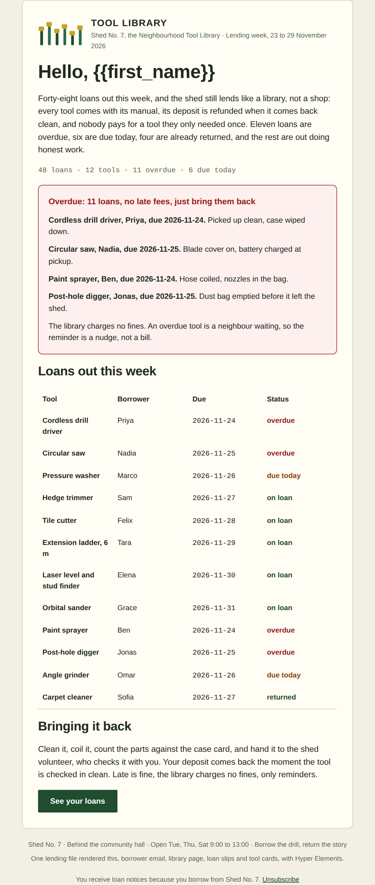
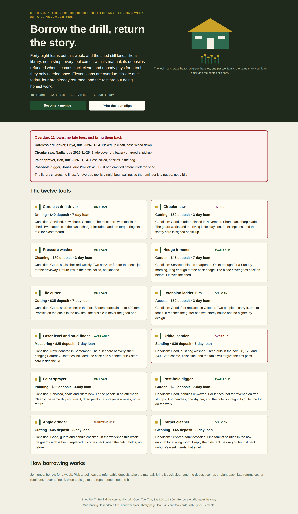
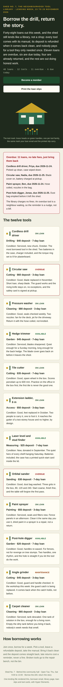
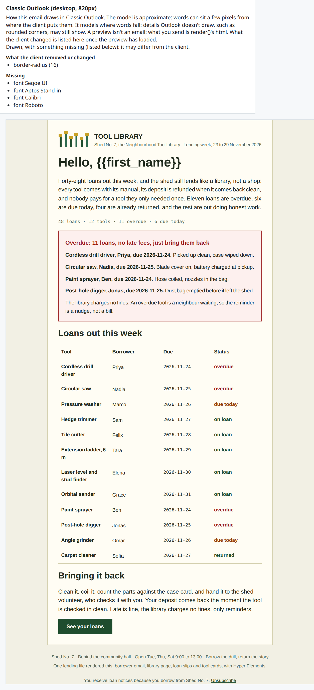
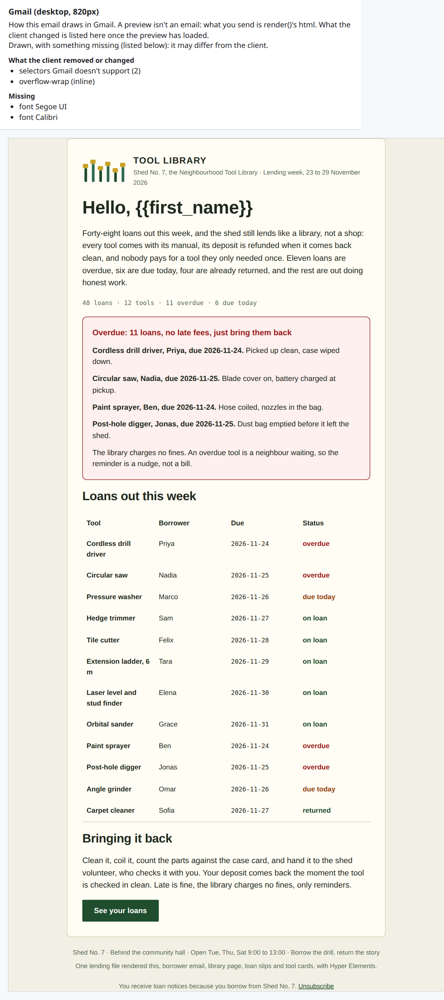

# TOOL LIBRARY: Borrow the drill, return the story

A Hyper Elements template kit for a community tool-lending library.
**One lending file** (`src/data/lending.ts`), twelve tools, each
with its category, deposit, loan period, condition and status, and
forty-eight loans, each with its borrower, dates and condition note , 
renders everything the library publishes that week: the borrower
emails, the public library page, the printed loan slips as a real PDF,
and the tool cards, from **one theme** and **one set of shared
components**.


*Every screenshot in this README is a photograph of a real render
(`npm run render` + `npm run shots`): if it is pictured, it was rendered.*

**Measured on the demo run (26 Nov 2026):** one lending file → **48
personalised borrower emails** (each borrower's own loan first, status
computed from the file), a **12-page loan-slip PDF** (one A4 slip per
tool, with its loans, a return checklist and a signature line), **12
tool cards** (one per tool), gate at **0 errors, 0 warnings**, batch
in **4.0s**. Reproduce it: `npm run check && npm run make`, then read
`out/checks.json` and `out/batch.json`.

| The borrower email (600px) | The library page (desktop) | The library page (mobile) |
|---|---|---|
|  |  |  |

| The loan slip (A4) | The email in Outlook | The email in Gmail |
|---|---|---|
|  |  |  |

The most borrowed tool as a card is in
[`examples/tool-card.png`](examples/tool-card.png).

## Why one lending file?

A tool library runs on trust and on dates. If the email says the
circular saw is due on the 25th and the slip on the shed counter says
the 28th, the saw comes back three days late and the next borrower
waits on a fence half built. This kit makes disagreement impossible
by construction: the email, the page, the slip and the cards are four
roots over one data file. And the kit's central rule is a library
rule:

> **A loan's status is computed, never typed.**

`dueStatus()` compares each loan's due date with the fixed today in
the file, so no output anywhere can call a loan "on loan" that the
file knows is overdue. The library charges no fines, so the overdue
block is a nudge, not a bill, and that is written into the copy, not
just the design. The **ToolMark** (a row of little tools, brass heads
on green handles, like the pegboard above a workbench) is built from
a `Row` of fixed-width `Column`s, so the same mark survives an
image-blocking inbox, a printed slip and a social card.

## The four outputs

| Output | Root | Script | What it is |
|---|---|---|---|
| Borrower email | `Email` → `render()` | `templates/borrower-email.tsx` | Per-borrower: their own loan first (tool, due date, deposit, condition note), the overdue list, the week's loans, the return checklist, MergeTag greeting, plain-text twin |
| Library page | `Page` → `render()` | `templates/library-page.tsx` | Shed hero with Svg shed art, every tool as a typed `library.ToolCard`, how borrowing works, no client-side JavaScript |
| Loan slips | `Document` → `renderPdf()` | `templates/loan-slips-document.tsx` | One A4 slip per tool to pin at the shed counter: facts, its loans with computed statuses, return checklist, signature line |
| Tool cards | `Canvas` → `renderImage()` | `templates/tool-canvas.tsx` | 1080x1080 PNGs, one per tool, the deposit and loan period as the heroes, on a deep forest ground |

## Run it

```bash
npm install
npm run check        # validate() gate: core + lint + email-clients -> out/checks.json
npm run render       # one of each output -> out/
npm run clients      # the email as Outlook / Gmail / Apple Mail draw it -> out/clients/
npm run make         # the batch: 48 emails + slips PDF + 12 cards
npm run make:sample  # same, 12 emails
npm run shots        # screenshots of the real renders -> docs/
npx hyper-elements check templates/   # 4 templates: 0 errors, 0 warnings, 0 skipped
```

Node 20+. The PDF and PNG steps take their fonts as files, see
`assets/fonts/README.md`. Without them the HTML still renders and the
scripts say exactly what is missing; nothing is ever fetched.

## How Hyper Elements is used

- **One `defineTheme()`** for all four roots: deep forest green,
  cream, brass, named `card` / `stamp` / `mono` / `brassRule` /
  `pineRule` styles, Button variants, per-format overrides. No
  `mobile` blocks in the theme, phone styles are an error in a
  Document or a Canvas.
- **Shared components across roots** (`Wordmark`, `ToolMark`,
  `WeekLine`, `LoanFacts`, `OverdueBlock`, `LoanTable`,
  `ToolLoansTable`), the emailed loan and the printed loan are the
  same loan.
- **Each root plays to its medium.** The Page gets full `Svg` shed
  art; the Email, which cannot hold an Svg, gets the ToolMark as
  layout instead.
- **A custom element with `defineElement()`**: `library.ToolCard`,
  typed props via `prop.text` / `prop.number` / `prop.choice`. A
  mistyped deposit is a diagnostic with a path, before anything
  renders.
- **`validate()` as a gate**: the batch validates before writing a
  single file; `out/checks.json` makes the verdict an artefact.
- **Token scopes for the dark grounds**: the Page hero and the Canvas
  card invert via `tokens` on a Section/Column.
- **Deterministic batch**: loan generation uses no clock and no
  randomness, and each repeat loan on a tool is staggered so no two
  loans on one tool share a borrower or a date, so a corrections run
  re-renders only changed records.

## Structure

```
src/theme.ts                  the one theme
src/data/lending.ts           the one lending file (+ borrowers)
src/components/shared.tsx     components shared by all four outputs
src/components/tool-card.tsx  library.ToolCard (defineElement)
templates/                    one default-exported component per output
scripts/                      check / render / clients / make / shots
examples/                     one real artefact of each kind
docs/                         design notes, screenshots
AGENTS.md                     twelve invariants an agent must not break
```

## Data & privacy

Shed No. 7 is a fictional library; its tools, borrowers and figures
are sample data generated in this repository. All borrowers are
fictional. No network calls, no credentials, no paid services.

## License

MIT, see `LICENSE`.
